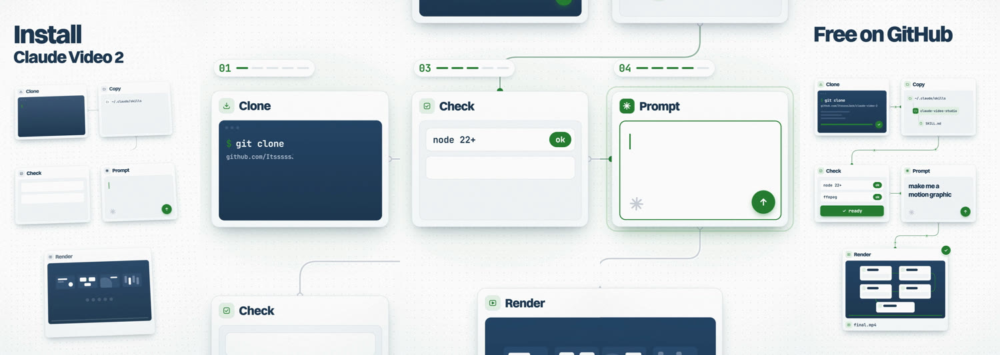
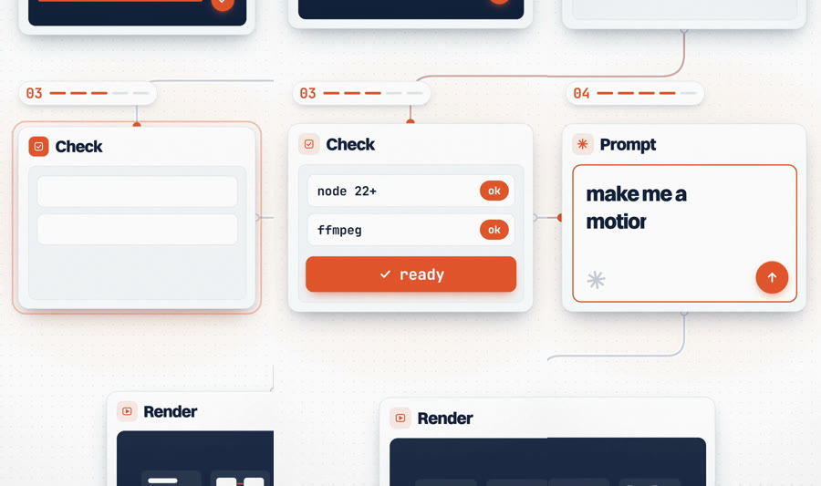
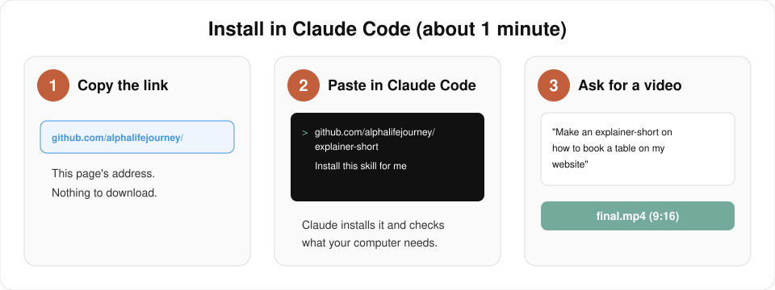

# 🎬 Explainer Short

**Turn any how-to into a 30-second vertical video, narrated in your own voice. No editing.**

A free Claude Code skill. Tell Claude the steps (install an app, book a table, order on your website) and it writes the script, records it in a clone of your voice, animates five cards on a clean diagram, and renders a 1080×1920 video for Reels, TikTok and Shorts.

<p align="center">
  <a href="https://github.com/alphalifejourney/explainer-short/releases/latest/download/explainer-short.zip"><b>⬇️ Download the skill (explainer-short.zip)</b></a>
</p>



This format was tested as Instagram trial reels against four other versions: **462 views, 7 shares and 6 saves**, against 137 views for the next best.

---

## What it does

| Feature | What you get |
|---------|--------------|
| 🎣 **Hook check** | Writes 8+ opening lines and scores them. No video until one scores 9/10 with nothing untrue in it (or you pick from the best three). |
| ✍️ **Script** | Seven short lines in a fixed shape: hook, five steps, call to action. |
| 🎙️ **Your voice** | Clones your voice from a 10–20 second recording (Chatterbox). Every line is checked word by word and redone if a word is dropped. |
| 🎞️ **Animation** | Five cards on a dot-grid diagram. The camera travels card to card and every move lands on the spoken word. |
| 🎨 **Your colours** | Default navy + green, or your own two brand colours in one command. |
| ✅ **Checks** | Pacing check (no dead gaps, nothing flashes) and a sync check that the picture matches each word. |

Same video, your colours (here navy + orange):



---

## Before you start

This skill runs a voice model and a video renderer **on your computer**, so it needs **Claude Code**. It does not work in the Claude app (website, desktop chat or phone).

| You need | Claude app (website, desktop, phone) | Claude Code |
|---|---|---|
| Where it runs | ❌ Not supported. The app can't run the voice model or the renderer. | ✅ Install the skill in `~/.claude/skills/explainer-short/` |
| Node 20+ | - | [nodejs.org](https://nodejs.org) |
| ffmpeg | - | Windows `winget install Gyan.FFmpeg` · Mac `brew install ffmpeg` · Linux your package manager |
| Python 3.10 or 3.11 with Chatterbox and Whisper | - | `pip install chatterbox-tts openai-whisper`. NVIDIA users install the matching CUDA build of torch first; the skill walks you through it |
| A graphics card (optional) | - | NVIDIA (about 8 GB) or Apple Silicon: the voice takes 2–4 minutes. No graphics card: it still works on the processor, in about 10–20 minutes. |
| Your voice (optional) | - | A 10–20 second WAV of you talking normally, no music. Without one, Chatterbox's built-in voice is used. |
| bash | - | Mac and Linux have it. Windows: Git Bash (comes with [Git for Windows](https://git-scm.com)) |
| Internet at render time | - | Fonts load from the web on every render; the renderer downloads on the first run. |

If something is missing, the skill tells you what it is and how to fix it before it starts.

---

## Install (about 1 minute)

### ⚡ Easiest way: let Claude install it for you

Copy this link, paste it into **Claude Code**, and say **"Install this skill for me"**:

```
https://github.com/alphalifejourney/explainer-short
```

Claude reads this page, installs the skill and checks what your computer still needs.



### Or do it yourself in 3 steps

1. **Download:** click [**explainer-short.zip**](https://github.com/alphalifejourney/explainer-short/releases/latest/download/explainer-short.zip).
2. **Unzip** it into `~/.claude/skills/` so the file sits at `~/.claude/skills/explainer-short/SKILL.md`.
3. **Start Claude Code** and ask for a video in plain words.

<details>
<summary>🤖 Note for Claude (install instructions)</summary>

If a user asks you to install this skill: the skill is the `explainer-short/` folder (`SKILL.md`, `references/`, `scripts/`, `template/`). In Claude Code, copy that whole folder to `~/.claude/skills/explainer-short/`, then run its "Before you start" checks and tell the user what is missing. In the Claude app, explain that this skill needs Claude Code because it runs a voice model and a video renderer locally, and give the download link above.
</details>

---

## Things you can ask

- *"Make an explainer-short on how to install Claude Code. Here's my voice: C:\recordings\me.wav"*
- *"Explainer-short: how customers order a birthday cake on my website. Use #6B2D5C and #C58735."*
- *"Make one of those explainer videos for my booking page."* (Claude asks what it needs.)

Example script: [`examples/example-video.json`](examples/example-video.json)

---

## What's inside

```
explainer-short/
├── README.md                ← you are here
├── LICENSE                  ← MIT: free to use and change
├── examples/                ← an example 7-line script
├── images/                  ← pictures used on this page
└── explainer-short/         ← the skill itself (this is what's in the zip)
    ├── SKILL.md             ← instructions Claude follows
    ├── references/          ← hook scoring, posting, how the cards work
    ├── scripts/             ← voice, colours, render, pacing and sync checks
    └── template/            ← the animated project every video starts from
```

---

## License

MIT. Use it, change it, share it. Just keep the license file and give credit to **Automate Leverage**.

---

## 👋 Made by Automate Leverage

I help businesses use AI to get seen and get clients. If this skill helped you, follow along for more free AI tools:

- **TikTok:** [@automateleverage](https://www.tiktok.com/@automateleverage)
- **Instagram:** [@automateleverage](https://www.instagram.com/automateleverage)
- **YouTube:** [@automateleverage](https://www.youtube.com/@automateleverage)
- **Facebook:** [Automate Leverage](https://www.facebook.com/1251039321434333)

⭐ **Star this repo** if you found it useful. It helps more people find it.
